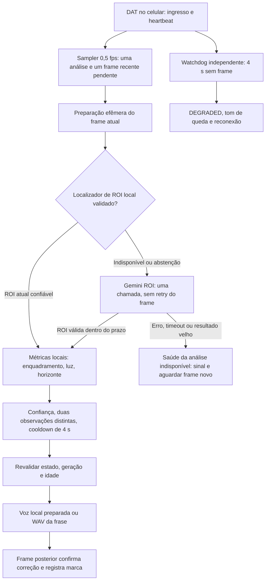

**Olivia — estratégia para aproximar o loop ao vivo de 900 ms**

Análise de código e documentação em 16/09/2026. A proposta inicial foi seguida por uma primeira
rodada segura de implementação e medição no Moto G60; os resultados instrumentados estão no
[relatório BE-07](BE07_MOTO_G60_2026-09-16.md). As partes de concorrência do runtime, modelo local,
WAV e validação de hardware continuam pendentes.

**Prioridade atual (17/09/2026):** a otimização da meta de 900 ms fica deliberadamente por último.
Até o fechamento dos gates offline, DAT/hardware, pós-processamento, privacidade e evidências, este
documento é baseline de medição; não alterar agora a cadência, o preview realtime, Porcupine/Rhino
ou o caminho híbrido existente.

**Recomendação:** em um dia, corrigir agendamento/frames antigos, instrumentar estágios, preparar áudio e otimizar o transporte existente. Não prometer que isso levará a mediana de 2257 ms a 900 ms. Para sustentar essa meta com maior previsibilidade, o caminho principal precisa de um localizador de ROI no celular, validado para a peça do cenário Olivia; Gemini fica como alternativa para frames em que a localização local se abstém. Esse localizador ainda não existe no código auditado.

900 ms com Gemini remoto é possível em condições favoráveis, mas **não é uma meta operacional defensável hoje neste Moto G60**, muito menos uma garantia de áudio físico nos óculos. Seria necessário reduzir cerca de 60% da mediana observada, sem perder qualidade ou esconder timeouts. Não há evidência de que configuração do SDK, streaming ou WAV entreguem essa redução.

**1. O que está sendo medido e onde o tempo provavelmente está**

Definir três relógios diferentes:

- `frame_received → audio_callback`: começa no ingresso do frame no celular e termina no callback Android. É a métrica atual aproximada, ainda sem DAT no ensaio.
- `frame_received → acoustic_onset`: termina no início audível nos óculos. Precisa de medição física própria.
- `problem_onset → acoustic_onset`: começa quando o problema aparece na cena. Inclui a espera pela amostra, a histerese e eventuais restrições de cooldown.

A 0,5 fps, a espera pela primeira amostra é de aproximadamente 0–2 s, com média de 1 s se o evento ocorrer uniformemente entre amostras. A política atual exige duas análises concordantes: normalmente há ainda um intervalo de 2 s até o frame que completa a decisão. Assim, mesmo com processamento de 900 ms, a primeira orientação sobre um problema novo pode chegar aproximadamente 2,9–4,9 s depois, em condições saudáveis e sem cooldown adicional. Confirmar uma correção exige outro frame, posterior à orientação. Não remover a histerese para melhorar artificialmente o indicador.

Para o caminho atual, a decomposição é:

`fila + preparação + codificação + App Check + transporte/rede + serviço/modelo + parsing + análise local + política/persistência + pedido de áudio → callback`.

A serialização do SDK pode estar incluída em preparação ou na chamada SDK: os spans precisam ser aninhados para não contar o mesmo custo duas vezes. O Bluetooth da câmera fica antes do ingresso no celular; o Bluetooth de saída continua além do callback. Se o timestamp disponível nasce após o decode HEVC, registrar também ingresso do pacote e saída do decoder, sem chamar o segundo de recebimento original.

| Etapa | Leitura do código / expectativa de engenharia | Como separar |
|---|---|---|
| Preparação do frame | JPEG é decodificado e reduzido. DAT percorre HEVC → NV21; a conversão e as cópias não aparecem no ensaio sintético da mesma forma. Dezenas de ms são plausíveis; não medidas. | Timestamp de ingresso, saída HEVC, início/fim de decode, resize e extração Y. |
| Compressão/serialização | O transporte faz NV21 → JPEG qualidade 80 → Bitmap → resize → `image(bitmap)`. A inspeção do AAR instalado confirmou que o último passo codifica outro JPEG qualidade 80 e Base64. Há uma recompressão evitável. | Tempo de cada conversão, dimensões e contagem de bytes, sem registrar conteúdo. |
| App Check | Inicialização, cache/renovação e provedor debug versus Play Integrity podem mudar cold start. O ensaio usa debug. Não atribuir vários segundos a App Check sem evidência. | Cold/warm e instrumentação temporal do provedor, quando suportada; nenhum token em relatório. |
| Rede | Inclui conexão, TLS, upload, gateway Firebase e download. Pode variar de dezenas/centenas de ms a segundos. Ainda misturada com o serviço. | Spans do cliente se acessíveis; rede A/B e chamadas controle são aproximações, não inferência pura. |
| Serviço/Gemini | Fila do serviço, processamento visual e geração do JSON. É candidato importante ao gargalo, junto com a rede, mas os 2236 ms não são uma medição isolada do modelo. | Primeiro chunk, conclusão e metadados numéricos disponíveis; sem telemetria de servidor, manter nome `sdk_round_trip`. |
| Parsing/validação | JSON curto com ROI; espera-se custo pequeno, geralmente ordem de poucos ms. Sem medição local ainda. | Span do `WorkAreaLocalizationSchema.decode`. |
| Análise local | Percorre luminância da ROI/frame e estima horizonte. O custo depende da resolução e do CPU. Não é apenas calcular centro de bbox. | Spans de luma, framing, light e horizon. |
| Política/timeline | O runtime faz persistência antes de falar; pode reescrever a timeline várias vezes por frame. Está ausente do ensaio. | Separar decisão, escrita de metadados e pedido de áudio. |
| TTS | Inicialização pode custar centenas de ms ou mais; voz pronta tende a custar menos. A inicialização já ocorre enquanto o primeiro Gemini está em andamento no teste. | `tts_ready`, pedido, `onBeginSynthesis`, `onStart`, término/erro. |
| Roteamento Bluetooth | Não medido. Bufferização, codec e retomada de rota podem acrescentar atraso variável ao som. | Mesmo áudio em alto-falante do celular e óculos, com referência temporal física. |

As ordens de grandeza acima são hipóteses para orientar a instrumentação, não uma decomposição numérica dos 2257 ms. O Android documenta `onStart` como callback pouco antes da reprodução; ele não certifica o instante acústico no headset. [Referência Android](https://developer.android.com/reference/android/speech/tts/UtteranceProgressListener).

Um **orçamento de projeto**, a ser comprovado para o caminho local, seria:

| Estágio | Teto de orçamento por chamada |
|---|---:|
| Agendamento e preparação | 100 ms |
| Localização de ROI local | 300 ms |
| Métricas locais | 70 ms |
| Política e metadados | 30 ms |
| Pedido de áudio até callback | 100 ms |
| Reserva para variação | 300 ms |
| Total | 900 ms |

Esse orçamento não é benchmark do Moto G60; somar orçamentos tampouco demonstra percentis. Para um caminho remoto, restariam aproximadamente 600 ms para codificação, rede, serviço e retorno, depois de reservar 300 ms para os demais estágios. Isso é muito diferente da evidência disponível. A meta acústica teria de reservar parte desses 900 ms para a saída Bluetooth.

**2. O que a campanha atual permite concluir**

O [teste existente](../../../apps/android/app/src/androidTestGlasses/kotlin/com/olivia/companion/ai/FirebaseLiveLoopMeasurementTest.kt) comprova que dez chamadas reais ao transporte Firebase, seguidas de TTS, completaram no aparelho daquela rodada:

| Métrica registrada | p50 | p95 |
|---|---:|---:|
| `analyzer.analyze` completo | 2236 ms | 5615 ms |
| Início do ensaio por frame até callback TTS | 2257 ms | 5957 ms |

Limitações específicas encontradas:

1. `timeoutMs = 30_000` no ensaio. Em produção, `GeminiFrameAnalyzer` aplica 2000 ms somente ao transporte; parsing e análise local ficam fora desse timeout. Logo, a campanha não representa a distribuição dos resultados aceitos na produção. O p50 total não permite calcular a taxa exata de timeout do transporte.
2. O JPEG sintético 512×512 é criado e comprimido antes do início do cronômetro. Não é um frame 720×1280 do DAT. A amostra não passa por captura, HEVC, sampling, timeline ou política de direção.
3. O campo `inference` engloba transporte, parsing, decode de luminância e análise local. Não é tempo de computação Gemini no servidor.
4. O teste força `TURN_RIGHT` e a frase “Vire para a direita.” após cada análise bem-sucedida, inclusive se a localização não gerar diagnóstico útil. Ele não mede qualidade visual, duas observações, cooldown ou confirmação.
5. O teste interrompe no primeiro erro e só imprime o agregado depois de dez sucessos. Uma campanha nova precisa publicar falhas e denominadores também.
6. Com nearest-rank e dez amostras, p95 é o maior valor observado; p50 é o quinto valor ordenado. São descrições dessa rodada, não cauda robusta nem comparação cold/warm.
7. `2257 − 2236 = 21 ms` não é o p50 do TTS. Calcular `audio_started[i] − audio_requested[i]` para cada amostra e só então obter percentis. A mesma regra vale para p95.
8. O mock, o schema aprovado e o App Check funcionando não comprovam qualidade na tatuagem real, Play Integrity em release, rota dos óculos, latência acústica ou bateria. O teste ROI atual pode passar com `targetPresent=false` e lista vazia de diagnósticos: passar nesse teste não demonstra que o alvo foi localizado.

Há ainda problemas de runtime que a campanha não exercita:

- `SessionRuntime.kt` segura `runtimeMutex` durante análise e espera de áudio; heartbeat, watchdog e comandos usam esse mutex. Isso pode atrasar PAUSE/STOP e a observação dos quatro segundos sem frame.
- `DatGlassesGateway.kt` usa buffer de um elemento com `tryEmit` sem tratar falha. Com consumidor ocupado, pode preservar um frame antigo e perder os mais novos antes do sampler.
- `Sampling.kt` verifica idade no início; falta um limite de idade total antes da direção/fala.
- `SessionCoordinator`/`FileTimeline` podem fazer até três reescritas da timeline antes de pedir áudio. Medir antes de redesenhar persistência.
- `LiveLoopMetrics` mistura duração de tentativas sem outcome, contagens acumuladas e janela de até 200 amostras. O relatório precisa distinguir sucesso, abstenção, timeout, erro, cancelamento e descarte por idade.

**3. Comparação das opções**

As faixas abaixo são **hipóteses de planejamento**, não benchmarks, SLAs ou probabilidades estatísticas. Faixas locais pressupõem modelo pequeno já qualificado, aquecido e áudio preparado. Faixas remotas são de chamadas completas em ensaio diagnóstico; produção continua limitada pelo timeout, portanto não deve falar deliberadamente após 6 s. O objetivo é início da voz, não som de confirmação genérico.

| ID / opção | Chance relativa de p50 ~900 ms | Latência de planejamento ou ganho provável | Custo operacional | Bateria | Complexidade |
|---|---|---|---|---|---|
| A. ROI por modelo local + métricas atuais | Maior, condicionada ao modelo correto | 200–900 ms por frame decisivo; comprovar no Moto | Sem tarifa por inferência; custo de modelo/qualificação | CPU/GPU aumenta; rádio diminui | Alta para qualidade; média se modelo pronto |
| B. Híbrido: local primeiro, Gemini quando incerto | Maior no ramo local; global depende da cobertura | Local 200–900 ms; remoto sujeito à distribuição A/B e deadline | Fração das chamadas de nuvem | Menos rádio, mais computação local; medir saldo | Alta |
| C. Visão clássica completa, incluindo ROI heurística | Alta para velocidade, baixa para robustez do alvo | 100–500 ms em hipótese simples; não validado | Sem tarifa | Tendência de carga pequena, sem prova | Média para demo; alta para generalizar |
| D. Manter Gemini remoto e otimizar conjunto | Baixa com a evidência atual | Base observada 2257/5957 ms; explorar p50 de 1,5–2 s como meta intermediária, não previsão | Cerca de 15–30 chamadas por take de 30–60 s, sem falhas | Rádio + decoder continuam ativos | Baixa/média |
| E. Pré-aquecer cliente, App Check via fluxo SDK e áudio | Baixa como solução isolada | Pode remover cold start; ganho warm pode ser nulo. Planejar ainda na ordem de segundos | Uma chamada sintética opcional adicional | Pequeno custo inicial; evitar keepalive artificial | Baixa |
| F. Reduzir resolução/bytes/prompt | Baixa isoladamente; útil junto com D | Ganho de ms a centenas de ms se preparo/upload dominarem; não assumir proporcionalidade a pixels | Bytes menores; tokens podem ou não diminuir | Menos cópias/upload; custo de resize | Baixa/média |
| G. Trocar modelo remoto/configuração de thinking | Incerta, precisa A/B | Não há faixa defensável distinta antes do ensaio; pode melhorar ou piorar a ordem de 1,5–6 s | Conforme modelo/tokens | Depende do tempo de rádio | Baixa no código; média na avaliação |
| H. `generateContentStream` | Baixa para este JSON curto | Primeiro token pode antecipar; ROI completa validada pode chegar quase no mesmo instante | Aproximadamente o mesmo conteúdo gerado | Aproximadamente equivalente; medir | Média |
| I. Outro backend/localidade via Firebase | Incerta, baixa prioridade em um dia | Varia com disponibilidade/localidade; nenhuma garantia subsegundo | Tarifação do backend; possível setup adicional | Rádio permanece | Média/alta |
| J. Firebase híbrido com Gemini Nano | Sem base para Moto G60 | Sem estimativa aplicável ao aparelho | Inferência local sem tarifa; nuvem cobra fallback | Depende do dispositivo/modelo | Alta e inadequada para este aparelho |
| K. Pipeline concorrente limitado + último frame | Baixa para acelerar Gemini; alta para evitar atraso acumulado | Remove espera na fila e sobrepõe preparo independente; não reduz o tempo do servidor | Igual ou menor, ao descartar trabalho obsoleto | Menos trabalho desperdiçado | Média |
| L. WAV/PCM de frases fixas, pré-carregado | Baixa isoladamente; útil para previsibilidade | Objetivo de pedido→callback de 10–100 ms; acústica adicional não medida | Sem tarifa; pequeno aumento do APK | Reduz síntese; não remove Bluetooth | Baixa/média |
| M. Rede estável, voz offline e persistência agrupada | Baixa isoladamente; reduz variação evitável | Ganho condicionado a rede/IO/TTS dominarem; medir, sem faixa total nova | Sem serviço adicional | Pode reduzir retransmissão/IO | Baixa/média |

Para custo financeiro, usar `N × (tokensEntrada × preçoEntrada + tokensSaída × preçoSaída) / 1.000.000`, somando thinking quando cobrado e chamadas de preparação. O SDK Firebase AI Logic não cobra tarifa própria; a API/modelo utilizado pode cobrar. No híbrido, `N_remoto` é a quantidade efetivamente enviada, não a taxa de frames recebidos. Não habilitar analytics remoto para obter esses números. [Preços e cobrança oficiais](https://firebase.google.com/docs/ai-logic/pricing).

| ID | Risco de qualidade | Privacidade | Cinco checkpoints | Aceitável para o hackathon? |
|---|---|---|---|---|
| A | Detector genérico pode achar braço/pessoa e errar a área da peça. Exigir ROI, ausência de alvo e oclusão avaliadas. | Melhor: frame não sai do aparelho no ramo local. | Compatível; modelo local deve ser IA funcional, sensores/áudio reais continuam necessários. | Sim, se modelo já validado; não prometer criação em um dia. |
| B | Abstenção/fallback precisam preservar confiança e origem; nunca combinar respostas de frames diferentes. | Só frames incertos seguem à nuvem, ainda sujeitos ao gate do provedor. | Compatível, com demonstração de ambos os ramos. | Sim como evolução; condicional para o dia. |
| C | Segmentação por cor/pele/bordas é frágil para a peça. Horizonte e luz local não resolvem a ROI. | Local e efêmero. | Câmera/áudio/privacidade/bateria compatíveis; heurística não comprova automaticamente IA. | Não como substituição completa recomendada. |
| D | Preserva desenho atual; qualidade no cenário real ainda pendente. | Envio efêmero pelo app; retenção do provedor é questão separada. | Compatível, sem prova física ainda. | Sim; recomendação inicial realista. |
| E | Sem mudança semântica se aquecimento sintético não gerar diagnóstico do usuário. | Não usar frame real para aquecer, nem armazenar respostas. | Compatível; contar custo extra na bateria. | Sim. |
| F | Perde detalhes/ROI pequena; crop fixo pode ocultar a peça. | Menos bytes não equivale a anonimização. | Compatível se qualidade/descarte preservados. | Sim, com A/B de qualidade. |
| G | Mesmo schema não garante mesma localização/confiança. | Conferir termos/configuração do modelo e backend. | Compatível se inferência real for demonstrada. | Sim, somente variante suportada e avaliada. |
| H | JSON parcial não autoriza orientação. | Mesmo envio; não logar chunks. | Compatível usando resultado completo. | Possível; baixo retorno esperado. |
| I | Reavaliar modelo, schema e erros. | Pode mudar termos, localidade e retenção. | Compatibilidade condicional à documentação/configuração. | Só se já preparado; não prioridade. |
| J | Sem garantia de schema local e sem aparelho suportado. | Local quando disponível; fallback pode continuar enviando imagens. | Não demonstrável nesse Moto pela hipótese proposta. | Não para resolver a meta atual. |
| K | Race conditions/frames vencidos se estado não for serializado. | Buffers limitados e liberados; sem cache de imagem entre análises. | Compatível e ajuda preservar sessão/queda. | Sim, prioridade alta. |
| L | Catálogo precisa cobrir frases qualitativas e estados; não anunciar cedo sem diagnóstico. | Assets próprios, sem áudio do usuário ou síntese remota. | Compatível: voz continua voz; Modo Sinal permanece separado. | Sim. |
| M | Política de áudio/rota e durabilidade das marcas devem permanecer corretas. | Voz offline e metadados mínimos; sem captura de tráfego/conteúdo. | Compatível. | Sim. |

Nenhuma linha declara os checkpoints aprovados. Ela indica compatibilidade arquitetural; evidência física e de dados continua necessária.

**4. O que Firebase/Android realmente permitem afirmar**

- O código fixa Firebase BoM `34.19.0`, DAT `0.9.0` e `gemini-3.5-flash-lite`. A documentação atual lista esse modelo e `gemini-3.1-flash-lite`; este último foi testado em A/B no Moto e ficou mais lento nesta sessão (p50 do SDK 4.542 ms contra 3.277 ms, 9/10 contra 10/10). Portanto, 3.5 permanece o controle e não há justificativa para trocar o padrão sem uma campanha maior e avaliação rotulada de qualidade. Não basear uma nova solução em Gemini 2.5 sem considerar a descontinuação documentada. [Modelos Firebase](https://firebase.google.com/docs/ai-logic/models).
- O POM disponível no cache Gradle resolve esse BoM para **`firebase-ai:17.17.0`**. Inspeção somente leitura do AAR confirmou: `image(bitmap)` codifica JPEG qualidade 80 + Base64; `content { inlineData(jpegBytes, "image/jpeg") }` aceita bytes preparados; `ThinkingLevel.MINIMAL` existe; `GenerationConfig` não expõe `mediaResolution`. Portanto, já há suporte local para comparar uma codificação explícita única em 512/384/320 e qualidade 80/65. O ganho e a qualidade continuam pendentes de medição. Essa inspeção não compilou nem executou o SDK.
- `gemini-3.5-flash-lite` já usa thinking `MINIMAL` por padrão segundo a documentação atual; o adapter agora também o declara explicitamente. Não esperar grande ganho de “desligar reasoning”: Gemini 3.x não permite desativá-lo como nos modelos 2.5. O probe de streaming no Moto mediu TTFT p50 de 1.714 ms e conclusão p50 de 1.852 ms, com seis chunks; a diferença curta entre primeiro e último chunk confirma que o atraso principal está antes da geração útil. [Thinking no Firebase](https://firebase.google.com/docs/ai-logic/thinking).
- Há streaming de saída multimodal no SDK Kotlin. Porém, para Olivia, presença/confiança/ROI completas e validadas precedem qualquer direção. TTFT não substitui tempo até resultado utilizável. A documentação também informa que configurar `media_resolution` ainda não é suportado pelo Firebase AI Logic: reduzir o Bitmap no app é diferente de configurar esse parâmetro do modelo. [Entrada de imagens e streaming](https://firebase.google.com/docs/ai-logic/analyze-images).
- `responseSchema`/JSON são suportados, mas não substituem a validação local de limites, finitude, área e campos proibidos. Não reduzir `maxOutputTokens=128` às cegas: uma saída truncada perde todo o resultado. [Saída estruturada](https://firebase.google.com/docs/ai-logic/generate-structured-output).
- Reutilizar as instâncias existentes ajuda; o transporte já guarda `model` em uma propriedade. Instanciar o objeto não garante conexão nem modelo remoto “quentes”. Uma chamada sintética opcional pode aquecer o caminho cliente/serviço, mas não reserva capacidade nem garante afinidade no servidor. Não há `warmUpModel()` demonstrado no código ou nas referências consultadas.
- Manter App Check e seu fluxo de cache/renovação do SDK. Não forçar refresh por frame e não desabilitar proteção para ganhar latência. Tokens de uso limitado/replay protection podem acrescentar custo/latência; não inferir sua configuração no console a partir do sucesso do teste. [App Check](https://firebase.google.com/docs/ai-logic/app-check).
- Gemini Developer API usa acesso global: não é possível presumir um parâmetro para fixar São Paulo. Outro backend pode oferecer escolha de localidade, com suporte de modelo/SDK a conferir. Isso não garante menor latência. Inserir Cloud Functions, Cloud Run ou um backend próprio adiciona caminho e não é solução inicial. [Localidade dos modelos](https://firebase.google.com/docs/ai-logic/locations).
- Firebase já documenta inferência híbrida Android experimental, mas a lista ML Kit não inclui Moto G60 e a integração local ainda não oferece todas as capacidades, incluindo saída estruturada. Não sugerir `PREFER_ON_DEVICE` como troca pronta para este caso. Um detector pequeno LiteRT é outro tipo de integração, não Gemini Nano. [Híbrido Android](https://firebase.google.com/docs/ai-logic/hybrid/android/get-started), [aparelhos ML Kit](https://developers.google.com/ml-kit/genai).
- A Live API é uma API distinta, com comportamento e modelos próprios. Não é apenas um transporte persistente do mesmo contrato ROI. Seu suporte não comprova equivalência de `responseSchema`/modelo; não incluir microfone remoto ou fala gerada na nuvem. Não a escolher para a intervenção de um dia. [Capacidades Live API](https://firebase.google.com/docs/ai-logic/live-api/capabilities).
- `setLanguage(pt-BR)` não garante voz offline. Selecionar uma voz instalada que não exija rede, verificar disponibilidade e ter WAV local como alternativa. Não armazenar síntese de conteúdo do usuário: as frases são catálogo fixo do produto. [Voice.isNetworkConnectionRequired](https://developer.android.com/reference/android/speech/tts/Voice).

**5. Arquitetura recomendada, fallback e meta honesta**

Arquitetura imediata: manter a ROI remota, corrigir scheduler/frames antigos, preparar saída local e conservar a falha controlada. Arquitetura alvo: usar ROI local validada no caminho principal.



O localizador do diagrama é uma evolução pendente; hoje o frame segue ao Gemini. A implementação deve ter um coordenador que serializa apenas transições curtas e um worker de análise fora desse lock. Heartbeats não aguardam esse worker. Manter uma chamada remota por vez, no máximo um frame recente pendente e liberar o frame substituído. Não construir uma fila de imagens nem iniciar várias inferências remotas concorrentes.

Em PAUSE/STOP ou mudança de `CaptureId`, cancelar análise/áudio pendentes e rejeitar resultados da geração anterior. Antes de falar, revalidar estado, sequência, idade desde ingresso e cooldown. Um token de geração também deve proteger a entrega ao executor de áudio para evitar corrida entre decisão e STOP. Ausência de frame por 4 s continua `DEGRADED`; erro de IA com frames chegando continua causa separada de indisponibilidade de análise.

No caminho local futuro, avaliar o mesmo frame com modelo compacto, por exemplo entrada 256/320 e quantização candidata. Isso é um experimento, não escolha comprovada. Medir CPU versus delegate realmente suportado e threads limitadas; não assumir aceleração só pelo nome do chipset. O desempenho deve ser medido no dispositivo alvo. [Boas práticas LiteRT](https://developers.google.com/edge/litert/conversion/tensorflow/build/best_practices).

Se o local se abstiver, fazer uma tentativa Gemini sobre o mesmo frame, somente enquanto ele ainda puder gerar resultado útil. O fallback remoto pode ser mais lento que 900 ms; medir e identificar esse ramo. Resultado local e remoto do mesmo frame contam como **uma observação**, nunca como as duas necessárias para a histerese. Não emitir segunda correção quando uma resposta remota chegar depois de uma decisão já aplicada.

Se nenhum caminho obtiver ROI atual confiável: suspender correções, emitir o sinal de indisponibilidade conforme política e tentar novamente com frame novo, com backoff limitado para indisponibilidade/rate limit. Preservar sessão e marcas; não atribuir falha ao Bluetooth sem perda de heartbeat. Isso é o fallback de produção disponível hoje. Não existe fallback útil simplesmente chamando `LocalVisualAnalysis`: ele depende da ROI e se abstém sem ela.

Não usar cache de bbox como prova de que a peça permanece naquele lugar. Optical flow/template tracking atravessando análises precisaria reter frame ou derivados além do lifetime atual; não faz parte desta proposta de um dia. São seguros para reutilização: instâncias SDK, modelo carregado, buffers sem conteúdo retido e PCM fixo do produto. Frames, crops, embeddings e respostas visuais não viram cache persistente. IMU do celular não mede a inclinação dos óculos apoiados em outra posição.

**Metas propostas, sem substituir evidência por intenção:**

- Hoje, comunicar o observado: p50 2,257 s e p95 5,957 s no ensaio sintético com callback TTS e timeout diagnóstico de 30 s.
- Em um dia, buscar p50 de 1,5–2 s nas chamadas remotas completas do ensaio e elevar a fração de respostas úteis antes do limite de produção. É meta de experimento, não resultado esperado garantido. Se não houver ganho, publicar o número real e manter a limitação aberta.
- Em produção, manter o timeout remoto de 2 s e acrescentar orçamento total de idade que desconte fila/preparo e reserve tempo para áudio. Timeout não pode virar sucesso de 2 s nas estatísticas. Não alegar p95 saudável apenas porque o prazo cortou a cauda.
- Com localizador qualificado, buscar p50 ≤900 ms no caminho local e publicar p95, cobertura local, qualidade, taxa de fallback e desempenho remoto separadamente. A mediana global só vale com a mistura real de ramos e falhas explicitada.
- Medir acústica dos óculos e latência desde o surgimento do problema em indicadores separados.

Pitch sugerido: “Na bancada Moto G60 com imagem sintética, medimos mediana de 2,26 segundos até o início reportado pelo TTS. Nossa meta é 900 ms. O app já calcula a direção localmente; a localização da peça ainda depende da nuvem. Estamos reduzindo esse caminho e avaliando localização local. A latência com câmera e áudio dos óculos terá medição própria.” Após uma nova campanha, substituir apenas os números efetivamente observados.

**6. Plano executável em um dia e vínculo com backlog**

| Janela aproximada | Entrega concreta | Backlog / dependências |
|---|---|---|
| 0–1,5 h | Spans por estágio, deltas pareados e outcome, relatório mesmo com falhas | BE-07: BE-03, BE-04, FE-04, BE-14 |
| 1,5–3,5 h | I/O fora do mutex, estado serializado, último frame e gates de geração/idade; cancelamento | BE-02: SH-04, BE-01; BE-03; FE-02/FE-09 |
| 3,5–4,5 h | Áudio pronto/offline; A/B 512 versus 384/320; remover conversão redundante somente se API verificada | FE-04: SH-04, FE-00; BE-03: SH-04, BE-01, BE-02, BE-13, BE-14 |
| 4,5–6,5 h | Campanha pequena ABBA por variante; separar qualidade de schema e comparar timeout real | BE-07, BE-03; INT-07 depende BE-07, BE-11, INT-04/05 e INT-00 |
| 6,5–8 h | Escolher configuração, registrar limitações, demonstração dos checkpoints disponível e backup mock identificado | BE-10, BE-11, INT-03 e INT-08 |

Essa janela supõe ambiente de medição pronto e autorização para executar os ensaios na etapa de implementação. Caso o refactor de concorrência exija mais tempo, priorizar correção de estado/freshness e instrumentação; deixar WAV, troca de modelo e outras variantes para depois. Não tentar treinar um detector novo, migrar backend e adotar Live API no mesmo dia.

BE-11 depende BE-02/04/07; INT-03 depende INT-01/02 e BE-03/10/11. A proposta é suporte necessário às tasks existentes, sem nova feature de produto. A mudança futura da fonte da ROI precisa ser registrada em BE-03 e nos contratos, com avaliação de qualidade; não deve ser marcada pronta por um demo de detector genérico.

**7. Mudanças concretas por arquivo**

Os caminhos abaixo são relativos à raiz do repositório. A tabela registra o plano completo; os itens
de transporte e instrumentação marcados no status abaixo já foram aplicados.

| Arquivo | Intervenção |
|---|---|
| `apps/android/core/src/main/kotlin/com/olivia/core/LiveLoopMetrics.kt` | Spans de fila/preparo/SDK/parse/local/política/áudio; outcome e cold/warm; deltas pareados; separar janela de contagem acumulada. Exportar somente agregados, versões e enums necessários. |
| `apps/android/core/src/main/kotlin/com/olivia/core/GeminiFrameAnalyzer.kt` | Separar transporte de processamento local nas métricas; orçamento restante desde ingresso; cancelamento cooperativo e descarte; nenhuma repetição do frame. Luma pode ser preparada junto com o transporte dentro do mesmo lifetime, se o custo medido justificar. |
| `apps/android/core/src/main/kotlin/com/olivia/core/SessionContract.kt` | Configuração explícita de idade máxima/deadlines, distinta da meta estatística; alimentar sampler/guidance a partir da mesma configuração. Preservar 0,5 fps, cooldown e degradação de 4 s. |
| `apps/android/core/src/main/kotlin/com/olivia/core/Sampling.kt` | Reposição explícita do frame pendente pelo mais recente, contagem de descartes e scheduler que respeite 2 s entre seleções. Evitar frame esperando mais o tempo integral de uma análise. |
| `apps/android/app/src/main/kotlin/com/olivia/companion/session/SessionRuntime.kt` | Retirar análise, áudio e IO demorado do lock de estado; jobs canceláveis; validar geração/idade antes de aplicar e falar; heartbeat/watchdog independentes. Registrar término em `finally`, sem duração zero artificial no cancelamento. |
| `apps/android/app/src/glasses/kotlin/com/olivia/companion/session/DatGlassesGateway.kt` | Resolver perdas silenciosas de `tryEmit`; garantir última amostra, heartbeat no ingresso e contadores antes dos descartes. Sem aumentar a taxa de análise. |
| `apps/android/app/src/glasses/kotlin/com/olivia/companion/session/HevcFrameDecoder.kt` | Medir ingresso/saída e custo de NV21; evitar conversões/cópias dispensáveis após decode quando seguro. Não descartar arbitrariamente pacotes HEVC: dependências do codec continuam necessárias. |
| `apps/android/app/src/glasses/kotlin/com/olivia/companion/ai/FirebaseGeminiVisualTransport.kt` | Parâmetros de experimento para maxEdge/prompt/modelo; spans; usar `inlineData` comprovado no SDK 17.17.0 para enviar JPEG preparado uma única vez. Para NV21, avaliar reduzir YUV e codificar uma vez, evitando JPEG intermediário e decode integral. Preservar geometria, schema e validação; comparar qualidade 80/65 antes de escolher. |
| `apps/android/app/src/glasses/kotlin/com/olivia/companion/ai/FirebaseVisualAnalyzerFactory.kt` | Reutilizar setup da sessão; escolher adapter/config sem esconder fallback; mais tarde injetar localizador local qualificado. Hoje `OLIVIA_AI_MODEL` do `.env` configura o teste, não o app instalado: levar a variante vencedora explicitamente à configuração do app. |
| `apps/android/app/src/glasses/kotlin/com/olivia/companion/ai/FirebaseAppCheckBootstrap.kt` | Inicializar cedo e uma vez por app; manter debug apenas na variante adequada e Play Integrity em produção. Nada de refresh por frame ou token em métrica. |
| `apps/android/app/src/main/kotlin/com/olivia/companion/ai/AndroidFrameLumaDecoder.kt` | Evitar decode JPEG duplicado quando uma representação preparada puder ser compartilhada com ownership claro; manter Y direto para NV21. Liberação ao final do pipeline. |
| `apps/android/core/src/main/kotlin/com/olivia/core/LocalVisualAnalysis.kt` | Spans separados; luminância/horizonte em resolução menor apenas após A/B de qualidade e coordenadas corretamente transformadas. Confiança de ROI não substitui avaliação da confiança de luz/horizonte. |
| `apps/android/app/src/main/kotlin/com/olivia/companion/audio/AndroidAudioFeedback.kt` | Estado de readiness e timeout/cancelamento do pedido; voz pt-BR offline; medir init/synthesis/start separadamente; opção PCM de frases fixas pré-carregadas. Não chamar `AudioTrack.play()` de onset físico. |
| `apps/android/app/src/main/res/raw/` — novos assets opcionais | Frases fixas próprias em WAV/PCM, sem dados capturados. Mapear para os mesmos diagnósticos e frases qualitativas. |
| `apps/android/core/src/main/kotlin/com/olivia/core/FileTimeline.kt` e `SessionCoordinator.kt` | Medir e agrupar escrita por frame antes de fazer refactor maior. Se tirar IO do caminho crítico, usar escritor único ordenado, tratar falhas e flush na parada; preservar durabilidade das marcas. |
| `apps/android/app/src/androidTestGlasses/kotlin/com/olivia/companion/ai/FirebaseLiveLoopMeasurementTest.kt` | Manter modo legado reproduzível; adicionar quantidade, preparação, cold/warm, matriz de resolução/deadline e resultados parciais sanitizados. Modo diagnóstico 30 s separado do modo produção 2 s. |
| `apps/android/app/src/androidTestGlasses/kotlin/com/olivia/companion/ai/FirebaseRoiIntegrationTest.kt` | Manter schema; acrescentar avaliação de ROI com verdade de referência autorizada e só métricas agregadas, sem logs da resposta. |
| `apps/android/app/src/androidTest/kotlin/com/olivia/companion/audio/AndroidAudioFeedbackInstrumentationTest.kt` | Casos de voz pronta/offline, ausência de voz, cancelamento, rota e comparação WAV/TTS. Acústica requer método físico adicional. |
| `apps/android/core/src/test/kotlin/com/olivia/core/` | Ao implementar concorrência/deadlines, cobrir STOP durante análise, heartbeat sem bloquear, frame substituído, mesma observação contada uma vez e confirmação com frame posterior. Não criar testes que apenas repitam a implementação. |
| `apps/android/gradle/libs.versions.toml` | Só alterar para uma capacidade necessária confirmada; não atualizar SDK indiscriminadamente como “otimização”. Dependência LiteRT apenas na evolução local. |
| Novos `WorkAreaLocalizer` e adapter Android local, nomes a definir | Separar contrato de ROI do transporte Gemini, preservar `WorkAreaLocalization`, origem e qualidade. Implementação posterior, dependente do gate de modelo. |
| `docs/rules/architecture-diagram.json`, `olivia-contracts.json`, `olivia_backlog.json` | Atualizar junto da implementação de deadline/fonte da ROI/origem dos resultados. Qualquer mudança de lifetime requer registro explícito de privacidade. |
| `docs/spec-driven-development/05-classificacao-visual`, `06-direcao-audio-e-timeline`, `09-privacidade-e-seguranca`, `10-medicao-e-evidencias` | Sincronizar status, política, método e resultados reais. Não fechar hardware/bateria por evidência sintética. |
| `.agents/skills/olivia-escopo-final/SKILL.md` e `docs/rules/excalidraw-report.json` | Corrigir narrativa antiga de “20 graus”/sombra causada pela mão e Gemini gerando três diagnósticos. Contrato atual e pedido do usuário prevalecem: Gemini só localiza a ROI. |

**Status da primeira execução segura (16/09/2026):** `FirebaseGeminiVisualTransport` agora codifica o
JPEG preparado uma única vez e usa `inlineData`, preservando qualidade 80, dimensões reduzidas,
prompt e schema. `GeminiFrameAnalyzer` e o teste BE-07 expõem spans agregados de decode, resize,
JPEG, round-trip do SDK, parse e análise local. A rodada no Moto confirmou que o round-trip remoto é
o gargalo dominante; não foram alterados thresholds, cadência, cooldown, histerese ou origem das
diagnoses. O runtime agora executa análise/TTS fora do mutex, usa um worker single-flight e cancela
o trabalho ativo em PAUSE/STOP, mantendo o commit protegido por geração. O tratamento de buffers
DAT, áudio WAV e modelo local exigem lotes separados com testes de regressão.

**8. Experimentos controlados no Moto G60**

Primeiro fazer triagem com 10–20 amostras por variante. Para finalistas, usar pelo menos 50–100 observações por condição e repetir blocos em horários/sessões diferentes; mesmo isso não vira garantia de p95. Alternar A/B/B/A para reduzir viés temporal, manter orientação da imagem, iluminação, modelo, rede, voz, temperatura do aparelho e estado de carga documentados. Campanha de consumo deve ter condições próprias, sem carregar por USB durante a medida de descarga.

| Experimento | Controle e variante | Resultado que separa |
|---|---|---|
| Processo frio versus sessão quente | Reiniciar processo versus reutilizar a mesma instância; registrar prontidão Firebase/TTS. Primeira chamada separada. | Cold start do processo. Não chamar isso de cold start do servidor. |
| Warm-up explícito | Sem chamada inicial versus uma chamada sintética antes da sessão; registrar seu custo e duração separadamente. | Se o benefício existe além das chamadas naturalmente aquecidas. |
| App Check | Debug configurado versus build apta a Play Integrity, com condições registradas; medir delegate temporalmente se SDK permitir. | Custo de atestação/configuração sem desativar enforcement. Não comparar como se fossem a mesma produção. |
| Rede versus serviço | Mesmo modelo/imagem em Wi-Fi estável e dados móveis; coletar tempos de conexão/upload/primeiro byte quando acessíveis. Controle textual mínimo no mesmo backend. | Sensibilidade à rede. Controle textual inclui serviço/modelo e não pode ser subtraído como “RTT puro”. |
| Gemini versus parser/local | Resposta JSON sintética em memória através do parser e métricas locais; depois transporte real com os mesmos spans. | Custo local; `sdk_round_trip` permanece rede + serviço sem telemetria própria. |
| Imagem/bytes | Sintético 512² legado versus sintético 720×1280; formatos JPEG/NV21; maxEdge 512/384/320. | Preparo, payload e acurácia. Normalizar a ROI sem distorcer aspect ratio. |
| Modelo/prompt | 3.5 Flash-Lite atual versus alternativa oficialmente disponível; prompt atual versus versão menor que preserve segurança/semântica. | Velocidade e qualidade; não somente JSON válido. |
| TTS versus WAV | Mesma frase sem chamada Gemini, engine frio/pronto, alto-falante do celular; depois repetir nos óculos. | Síntese, pedido→callback e estabilidade da saída. |
| Rota versus callback | Instrumentação física sincronizada de trigger e início do áudio nos óculos. Usar somente frase/tom sintético em bancada. | Offset acústico. Medição externa pode processar sinal em RAM e guardar apenas durações, sem salvar áudio bruto ou terceiros. Declarar erro de sincronização. |
| Sintético versus DAT | Legado → NV21 sintético → MockDeviceKit → DAT físico 720×1280. Não igualar mock a hardware. | Custo do decoder, transporte de entrada, perdas/fila e rota real. |
| Produção real | Pipeline completo com timeout 2 s, duas observações, cooldown, timeline, PAUSE/STOP e queda. | Cobertura, falhas, idade da instrução e correção confirmada. |
| Energia | Mesma cena/taxa/duração, várias sessões 30–60 s; comparar baseline, variantes e local quando existir. | Energia do celular e óculos separadas; temperatura e método/resolução da medida. |

Registrar em memória por tentativa: ingress/selected/prepared/request/response/validated/local_finished/audio_requested/audio_callback, outcome, ramo local/remoto, formato, dimensões e contagem de bytes. Somente agregados e configuração sem segredo vão ao relatório. Em spans concorrentes, registrar overlap; não somar todos os tempos como se fossem seriais. Não exportar frames, crops, hashes de imagem, embeddings, ROI por frame, respostas do modelo, texto bruto, áudio ou identificadores do dispositivo.

Relatar p50/p95 **dos sucessos**, mas ao lado de tentativas, timeouts, erros, abstenções, descartes, número com áudio e fração de oportunidades elegíveis que receberam orientação correta dentro de 900/2000 ms. Silêncio por “tudo correto” e silêncio por falha são categorias distintas. Aumentar abstenção para baixar a mediana não é melhoria do produto.

Para qualidade, medir localização da área certa, erro/IoU da ROI quando houver referência autorizada, falso positivo de direção, peça ausente, mão ocluindo, luz e horizonte incertos. Cada frame real continua efêmero: usar avaliação em memória ou protocolo consentido de observador com contagens, sem criar dataset de capturas da sessão. Não atribuir causalidade de sombra à mão. Com gravação nativa e DAT simultâneos, repetir apenas quando a capacidade já estiver comprovada pela matriz própria.

**9. Comandos e testes para repetir a medição**

Comandos abaixo foram escritos a partir dos arquivos locais, **não executados**. O teste instrumentado faz chamadas reais e requer aparelho conectado, Android SDK/JDK e configuração Firebase local já preparada. `app/build.gradle.kts` lê, por allowlist, `OLIVIA_LIVE_AI_ENABLED`, `OLIVIA_AI_MODEL` e `FIREBASE_APP_CHECK_DEBUG_TOKEN` do ambiente ou `.env` ignorado; não lê esses três valores de `local.properties`. Não colocar o token em argumento `-P`, `adb shell am instrument -e`, histórico ou corpo de relatório.

Com `.env` privado já configurado e um único aparelho conectado:

```powershell
Set-Location 'G:\Github\olivia-glass\apps\android'

# Não é segredo; a credencial continua no mecanismo privado já configurado.
$env:OLIVIA_LIVE_AI_ENABLED = 'true'
$env:OLIVIA_AI_MODEL = 'gemini-3.5-flash-lite'

# Evita misturar a tag agregada com uma execução anterior.
adb logcat -c

.\gradlew.bat :app:connectedGlassesDebugAndroidTest `
  '-Pandroid.testInstrumentationRunnerArguments.class=com.olivia.companion.ai.FirebaseLiveLoopMeasurementTest' `
  --console=plain --quiet --no-daemon --no-configuration-cache 1>$null 2>$null
$oliviaMeasurementExitCode = $LASTEXITCODE
Write-Output "measurement_exit_code=$oliviaMeasurementExitCode"

# Ler somente a tag de agregado, sem dump geral do logcat.
adb logcat -d -v brief 'OliviaBE07:I' '*:S'
```

Esse comando repete as dez amostras sintéticas atuais e o timeout diagnóstico de 30 s. Ele também compila/instala os APKs necessários. Não mede DAT, política completa nem energia. Reexecutar inicia outra rodada e pode misturar diferentes estados de aquecimento; não concatenar os agregados como se fossem amostras individuais.

Para o teste de schema/ROI existente, com a mesma configuração privada:

```powershell
.\gradlew.bat :app:connectedGlassesDebugAndroidTest `
  '-Pandroid.testInstrumentationRunnerArguments.class=com.olivia.companion.ai.FirebaseRoiIntegrationTest' `
  --console=plain --quiet --no-daemon --no-configuration-cache 1>$null 2>$null
$oliviaRoiExitCode = $LASTEXITCODE
Write-Output "roi_test_exit_code=$oliviaRoiExitCode"
```

Para o teste de áudio existente isolado de inferência:

```powershell
$env:OLIVIA_LIVE_AI_ENABLED = 'false'
.\gradlew.bat :app:connectedMockDebugAndroidTest `
  '-Pandroid.testInstrumentationRunnerArguments.class=com.olivia.companion.audio.AndroidAudioFeedbackInstrumentationTest' `
  --console=plain --quiet --no-daemon --no-configuration-cache 1>$null 2>$null
$oliviaAudioExitCode = $LASTEXITCODE
Write-Output "audio_test_exit_code=$oliviaAudioExitCode"
```

Código de saída zero indica que o comando completou com sucesso; valor diferente de zero não autoriza afirmar que houve medição válida. A saída bruta do Gradle é descartada para evitar imprimir mensagens internas do runner; o resultado público é apenas código de saída e tag agregada. Para investigar falhas, inspecionar localmente apenas dados sanitizados, sem compartilhar logs brutos.

Não usar `--debug`, `--info`, build scan, HTTP logging, dumps de `.env` ou logcat completo. O token debug ainda precisa atravessar o runner local de instrumentação; esses comandos evitam imprimi-lo no comando/terminal, mas isso não é uma promessa de ausência de segredo em memória/processos internos. Não publicar relatórios de teste brutos, APKs de debug ou diretórios `app/build` sem sanitização: bibliotecas de debug podem registrar dados próprios. O único artefato compartilhável desta campanha é o agregado allowlisted. Manter o token debug restrito ao desenvolvimento.

Os experimentos de 50/100 amostras, cold/warm, estágios, WAV e deadline real **ainda não têm parâmetros implementados nesse teste**. Primeiro adicionar os modos descritos no item 7; depois expor argumentos não secretos. Não inventar flags como `samples=100` esperando que o teste atual as respeite. O teste de áudio existente tampouco é a nova campanha acústica.

Testes de regressão a selecionar quando a implementação for autorizada: `CaptureFenceTest`, `SamplerPipelineIntegrationTest`, `SessionCoordinatorTest`, `GeminiFrameAnalyzerTest`, `LiveLoopMetricsTest`, `RoiToGuidanceIntegrationTest` e casos Android de cancelamento/readiness. Os novos cenários devem provar que STOP/PAUSE e heartbeat continuam atendidos durante rede lenta, que frame velho não fala e que duas respostas do mesmo frame não contam como duas observações.

**10. Privacidade, bateria e os cinco checkpoints**

| Checkpoint do edital | Evidência necessária e efeito da proposta |
|---|---|
| IA | Gemini ou detector local funcional, com qualidade demonstrada. A seção 8.1 aceita API, nuvem ou processamento local; não exige Gemini nem estabelece 900 ms. |
| Câmera ou microfone dos óculos | DAT real como entrada principal. Frame sintético, câmera do celular ou MockDeviceKit não encerram esse checkpoint. |
| Áudio | Frase/tom realmente ouvido nos alto-falantes dos óculos; callback Android isolado não basta. |
| Privacidade | Demonstrar descarte local e justificar tratamento no provedor, além de manter microfone fora da IA ao vivo. |
| Bateria | Estratégia 0,5 fps, sessão curta e saída local, acompanhada de medição com método explícito. Menos inferências não significa redução proporcional de energia. |

Fonte: [regras locais, seção 8.1](../../rules/hackaton-rules.json). A agenda usa a expressão “IA local”, enquanto o critério detalhado aceita nuvem; registrar a diferença e alinhar no onboarding. A seção 9 prevê aparelhos fornecidos pela organização: repetir as medições no celular e óculos do evento. O Moto G60 é bancada, não garantia de desempenho nesse equipamento.

No código atual, o gateway solicita stream DAT HIGH/HEVC a 2 fps; a análise continua amostrada a 0,5 fps. A dimensão efetivamente recebida precisa ser registrada, em vez de inferida apenas do preset HIGH. Decodificar vídeo comprimido pode exigir processamento entre amostras. Evitar conversão/cópia/inferência dispensáveis depois do decode, mas não quebrar dependências do codec nem reduzir a resolução de captura contratada só para reduzir upload. Comparar energia e temperatura de celular e óculos separadamente; queda de bateria de 0% em um take curto pode ser apenas falta de resolução do medidor.

O contrato do projeto já distingue descarte local de retenção pelo provedor. App Check protege acesso, não prova retenção zero. Os termos atuais do Gemini diferenciam serviços pagos e não pagos; mesmo serviços pagos podem ter retenção limitada para segurança. Portanto, não prometer “nenhum armazenamento em qualquer lugar” só porque `Bitmap.recycle()` foi chamado. Manter os gates BE-10/13 antes de mídia real. Se a exigência for retenção zero absoluta, a opção segura arquiteturalmente é o caminho integralmente local ou uma configuração de serviço cuja política tenha sido explicitamente comprovada. [Termos oficiais Gemini](https://ai.google.dev/gemini-api/terms).

Nenhuma proposta adiciona login, Firestore, upload de vídeo, analytics, microfone remoto, novos diagnósticos, análise a 30 fps ou editor. Wake word permanece no trabalho existente do frontend, no celular. Vídeo 3K e transcrição continuam após STOPPED. Backup mock permanece determinístico, offline e identificado como simulação.

**Decisão técnica:** executar primeiro a melhoria mensurável do pipeline atual. Promover ROI local a caminho principal somente depois de comprovar qualidade e tempo no dispositivo. Até lá, manter o timeout e o fallback seguro, publicar a cobertura junto da latência e apresentar 900 ms como meta em aberto.
